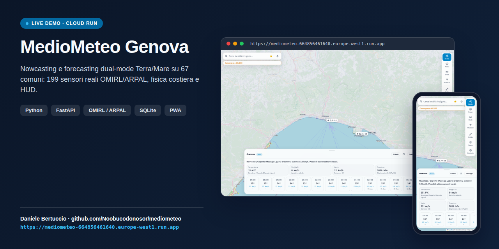

# MedioMeteo Genova

[](https://mediometeo-664856461640.europe-west1.run.app)

**Demo Live (Cloud Run):** [https://mediometeo-664856461640.europe-west1.run.app](https://mediometeo-664856461640.europe-west1.run.app)

Piattaforma full-stack di **Nowcasting (0–3h)** e **Forecasting (7 giorni)** ad alta risoluzione per la **Città Metropolitana di Genova (67 comuni, Terra)** e il **Golfo Ligure (Mare)**, sviluppata con metodologia **ADR-Driven**.

## Funzionalità Principali
- **Interfaccia v4.0 Full-Screen Map-First (`ADR-0013`):** mappa OpenStreetMap + OpenSeaMap a tutto schermo, livelli rapidi (`Vento`, `Radar`, `Onde`, `Stazioni`), bottom sheet progressivo e **Modalità avanzata** separata per analisi tecnica e 5 modelli.
- **AI Meteo Contestuale (`POST /api/v1/ask`):** domande dirette sul punto selezionato tramite Google Gemini con fallback deterministico immediato.
- **Copertura geografica granulare:** 67 comuni della provincia di Genova, 25 quartieri cittadini e rade costiere.
- **Ingestione dati reali OMIRL & ARPAL:** 199 sensori reali liguri (stazioni meteo, idrometri, webcam) + modelli LAM ad alta risoluzione (AROME 1.3 km, ICON-D2 2 km, ECMWF, GFS, MET.no, Open-Meteo Marine).
- **Modalità Dual-Mode (Terra / Mare):**
  - *Terra:* pioggia mm/h, vento in km/h, vallate, criticità idrogeologiche e idrometri torrenti.
  - *Mare:* fisica costiera (nodi, onda $H_s$/$H_{\max}$, periodo, risacca, maree, correnti), calcolatore rotta ETA e modalità Smartwatch HUD (`/orologio`).
- **Resilienza & Sicurezza:** gestione API key via `.env`, protezione anti-spoofing rate limiter, circuit breaker, cache SQLite con TTL e suite offline deterministica (`pytest`).

## Stack Tecnologico
- **Backend:** Python 3.11+, FastAPI, SQLite, Async HTTP connectors, Google Gemini (`google-genai`), `pytest`
- **Frontend:** Progressive Web App (PWA) responsive, Leaflet.js + Chart.js self-hosted
- **Architettura & Governance:** 13 Architecture Decision Records in [`docs/adr/README.md`](./docs/adr/README.md)

## Avvio Locale
```bash
python3 -m venv .venv && source .venv/bin/activate
pip install -r requirements.txt
cp .env.example .env
pytest
```
