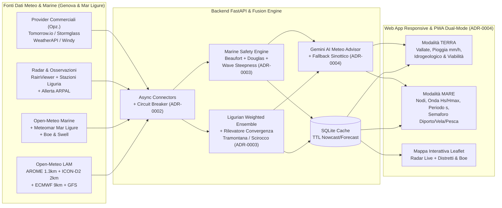

# Architecture Decision Records (ADR) & Master Task Backlog — MedioMeteo Genova

Questa cartella raccoglie gli **Architecture Decision Records (ADR)** e il **Backlog Operativo** del progetto **MedioMeteo Genova** (`Noobucodonosor/mediometeo`), la piattaforma di **Nowcasting (0-3h)** e **Forecasting (fino a 7 giorni)** ad altissima risoluzione per la **Provincia di Genova (Terra)** e il **Golfo Ligure (Mare)**.

---

## Indice degli ADR

| ID | Titolo | Stato | Priorità | Autori / Fonti |
| :--- | :--- | :--- | :--- | :--- |
| **[ADR-0001](./0001-core-architecture.md)** | Architettura Core, Zonizzazione Provincia di Genova (Terra/Mare) e Stack Tecnologico | Accettato (Baseline) | **P1 — Alta** | `@Noobucodonosor` |
| **[ADR-0002](./0002-security-resilience-apikeys.md)** | Sicurezza, Gestione API Keys, Resilienza Anti-Blackout e Disclaimer Incolumità | Accettato | **P0 — Critica** | `@Noobucodonosor` |
| **[ADR-0003](./0003-multi-model-nowcast-forecast-engine.md)** | Motore di Fusione Multi-Modello (Ensemble LAM AROME/ICON-D2/ECMWF) e Nowcasting Terra/Mare | Accettato | **P1 — Alta** | `@Noobucodonosor` |
| **[ADR-0004](./0004-dual-mode-pwa-ai-advisor.md)** | Web App PWA Dual-Mode (Terra/Mare), Mappa Radar/Nautica Interattiva e AI Meteo Advisor (Gemini) | Accettato | **P1 — Alta** | `@Noobucodonosor` |

---

## Diagramma Architetturale del Sistema

---

## Master Task Backlog (Tutti i Task Censiti)

> **Nota:** Lo stato live (`Open` / `Closed`) di ciascun task è tracciato sulle **GitHub Issues** del repository `Noobucodonosor/mediometeo`. Usa `closes #<NumeroIssue>` nei commit per chiuderle automaticamente.

| Task ID | Issue | ADR | Titolo Task | File Coinvolti | Priorità | Assegnatari |
| :--- | :--- | :--- | :--- | :--- | :--- | :--- |
| **TASK-CORE-01** | `#1` | [ADR-0001](./0001-core-architecture.md) | Setup struttura FastAPI, distretti Genova Terra/Mare e cache SQLite | `backend/config.py`, `backend/districts.py`, `backend/cache.py`, `backend/main.py` | **P1 — Alta** | `@Noobucodonosor` |
| **TASK-SEC-01** | `#2` | [ADR-0002](./0002-security-resilience-apikeys.md) | Hardening `.env`, geofencing Liguria, circuit-breaker e fallback cache | `backend/config.py`, `backend/security.py`, `.env.example` | **P0 — Critica** | `@Noobucodonosor` |
| **TASK-ENG-01** | `#3` | [ADR-0003](./0003-multi-model-nowcast-forecast-engine.md) | Motore Ensemble Multi-Modello (AROME, ICON-D2, ECMWF), Radar Nowcasting e Convergenza Ligure | `backend/engine/connectors.py`, `backend/engine/ensemble.py`, `backend/engine/ligurian_diagnostics.py` | **P1 — Alta** | `@Noobucodonosor` |
| **TASK-MAR-01** | `#4` | [ADR-0003](./0003-multi-model-nowcast-forecast-engine.md) | Motore Meteo-Marino (Onde, Swell, Periodo, Beaufort, Douglas, Ripidità d'onda e Sicurezza Mare) | `backend/engine/marine.py`, `backend/engine/alerts.py` | **P1 — Alta** | `@Noobucodonosor` |
| **TASK-AI-01** | `#5` | [ADR-0004](./0004-dual-mode-pwa-ai-advisor.md) | AI Meteo-Marine Advisor con Google Gemini (`google-genai`) e fallback sinottico esperto | `backend/engine/ai_advisor.py`, `backend/main.py` | **P2 — Media** | `@Noobucodonosor` |
| **TASK-UI-01** | `#6` | [ADR-0004](./0004-dual-mode-pwa-ai-advisor.md) | Web App Responsive + PWA Dual-Mode (Terra/Mare), Mappa Radar/Nautica Leaflet e Grafici Multi-Modello | `frontend/index.html`, `frontend/styles.css`, `frontend/app.js`, `frontend/manifest.json` | **P1 — Alta** | `@Noobucodonosor` |
