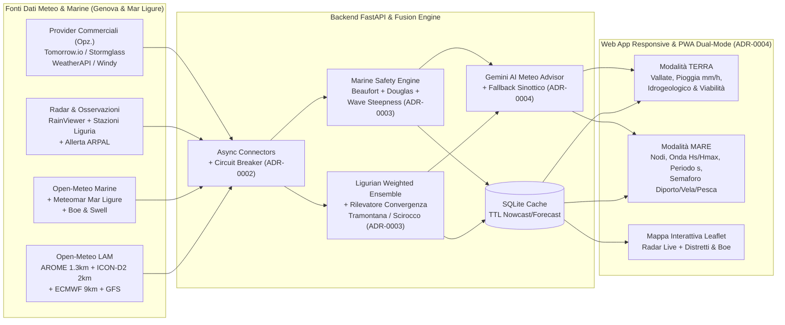

# Architecture Decision Records (ADR) & Master Task Backlog — MedioMeteo Genova

Questa cartella raccoglie gli **Architecture Decision Records (ADR)** e il **Backlog Operativo** del progetto **MedioMeteo Genova** (`Noobucodonosor/mediometeo`), la piattaforma di **Nowcasting (0-3h)** e **Forecasting (fino a 7 giorni)** ad altissima risoluzione per la **Provincia di Genova (Terra)** e il **Golfo Ligure (Mare)**.

---

## Indice degli ADR

| ID | Titolo | Stato | Priorità | Autori / Fonti |
| :--- | :--- | :--- | :--- | :--- |
| **[ADR-0001](./0001-core-architecture.md)** | Architettura Core, Zonizzazione Provincia di Genova (Terra/Mare) e Stack Tecnologico | Accettato (Baseline) | **P1 — Alta** | `@Noobucodonosor` |
| **[ADR-0002](./0002-security-resilience-apikeys.md)** | Sicurezza, Gestione API Keys, Resilienza Anti-Blackout e Disclaimer Incolumità | Accettato | **P0 — Critica** | `@Noobucodonosor` |
| **[ADR-0003](./0003-multi-model-nowcast-forecast-engine.md)** | Motore di Fusione Multi-Modello (Ensemble LAM AROME/ICON-D2/ECMWF) e Nowcasting Terra/Mare | Accettato | **P1 — Alta** | `@Noobucodonosor` |
| **[ADR-0004](./0004-dual-mode-pwa-ai-advisor.md)** | Web App PWA Dual-Mode (Terra/Mare), Mappa Radar/Nautica Interattiva e AI Meteo Advisor (Gemini) | Sostituito / Esteso da ADR-0005 & ADR-0006 | **P1 — Alta** | `@Noobucodonosor` |
| **[ADR-0005](./0005-omirl-observations-webcams-67-comuni.md)** | Catalogo Geografico Granulare (67 Comuni + 25 Quartieri + Rade), Rete Osservativa Reale OMIRL (Sensori, Idrometri, Webcam) e Bollettini Ufficiali ARPAL | Accettato | **P1 — Alta** | `@Noobucodonosor` |
| **[ADR-0006](./0006-pure-marine-physics-6tabs-eta-smartwatch.md)** | Fisica Costiera Pura (Zero Semafori in Mare, Risacca, Maree, Correnti), Architettura UX "Map-First" a 6 Schede Chiuse e Calcolatore Rotta ETA / Smartwatch | Accettato | **P1 — Alta** | `@Noobucodonosor` |
| **[ADR-0007](./0007-live-omirl-bulk-svg-instrumentation-flagship-ui.md)** | Ingestione Massiva Bulk REST OMIRL (199 Sensori Reali Liguri) e UI Strumentale "Biglietto da Visita" (Compact HUD, Mappa Full-Canvas Vettoriale & Quadranti SVG) | Accettato | **P0 — Critica** | `@Noobucodonosor` |
| **[ADR-0008](./0008-taste-skill-anti-slop-full-omirl-fusion.md)** | Fusione Multi-Sensore Completa OMIRL, Refactoring Anti-Slop (`taste-skill 2.5.1`) e Upgrade Smartwatch HUD (`/orologio`) | Accettato | **P1 — Alta** | `@Noobucodonosor` |
| **[ADR-0009](./0009-surgical-ux-comfort-anti-slop-roadmap.md)** | Roadmap Chirurgica UX Comfort & Anti-Slop (`taste-skill 2.5.1`) — 1 Agente Singolo su 1 Pezzo alla Volta (Milestone `v3.0`) | Proposto | **P0 — Critica** | `@Noobucodonosor` |
| **[ADR-0010](./0010-spatial-tiering-and-cartographic-clarity.md)** | Spatial Tiering & Cartographic Clarity per la Rete OMIRL (199 Sensori) | Proposto | **P1 — Alta** | `@Noobucodonosor` |
| **[ADR-0011](./0011-frontend-api-security-hardening.md)** | Frontend & API Security Hardening (XSS Escaping, Input Validation, Rate Limiting, Single-Flight & CSP/SRI) | Proposto | **P0 — Critica** | `@Noobucodonosor` |
| **[ADR-0012](./0012-cicd-deterministic-testing.md)** | CI/CD Pipeline, Deterministic Contract Testing & Browser Gate | Proposto | **P1 — Alta** | `@Noobucodonosor` |

---

## Diagramma Architetturale del Sistema

---

## Master Task Backlog (Tutti i Task Censiti)

> **Nota:** Lo stato live (`Open` / `Closed`) di ciascun task è tracciato sulle **GitHub Issues** del repository `Noobucodonosor/mediometeo`. Usa `closes #<NumeroIssue>` nei commit per chiuderle automaticamente.

| Task ID | Issue | ADR | Titolo Task | File Coinvolti | Priorità | Assegnatari |
| :--- | :--- | :--- | :--- | :--- | :--- | :--- |
| **TASK-CORE-01** | `#1` | [ADR-0001](./0001-core-architecture.md) | Setup struttura FastAPI, distretti Genova Terra/Mare e cache SQLite | `backend/config.py`, `backend/districts.py`, `backend/cache.py`, `backend/main.py` | **P1 — Alta** | `@Noobucodonosor` |
| **TASK-SEC-01** | `#2` | [ADR-0002](./0002-security-resilience-apikeys.md) | Hardening `.env`, geofencing Liguria, circuit-breaker e fallback cache | `backend/config.py`, `backend/security.py`, `.env.example` | **P0 — Critica** | `@Noobucodonosor` |
| **TASK-ENG-01** | `#3` | [ADR-0003](./0003-multi-model-nowcast-forecast-engine.md) | Motore Ensemble Multi-Modello (AROME, ICON-D2, ECMWF), Radar Nowcasting e Convergenza Ligure | `backend/engine/connectors.py`, `backend/engine/ensemble.py`, `backend/engine/ligurian_diagnostics.py` | **P1 — Alta** | `@Noobucodonosor` |
| **TASK-MAR-01** | `#4` | [ADR-0003](./0003-multi-model-nowcast-forecast-engine.md) | Motore Meteo-Marino (Onde, Swell, Periodo, Beaufort, Douglas, Ripidità d'onda e Sicurezza Mare) | `backend/engine/marine.py`, `backend/engine/alerts.py` | **P1 — Alta** | `@Noobucodonosor` |
| **TASK-AI-01** | `#5` | [ADR-0004](./0004-dual-mode-pwa-ai-advisor.md) | AI Meteo-Marine Advisor con Google Gemini (`google-genai`) e fallback sinottico esperto | `backend/engine/ai_advisor.py`, `backend/main.py` | **P2 — Media** | `@Noobucodonosor` |
| **TASK-UI-01** | `#6` | [ADR-0004](./0004-dual-mode-pwa-ai-advisor.md) | Web App Responsive + PWA Dual-Mode (Terra/Mare), Mappa Radar/Nautica Leaflet e Grafici Multi-Modello | `frontend/index.html`, `frontend/styles.css`, `frontend/app.js`, `frontend/manifest.json` | **P1 — Alta** | `@Noobucodonosor` |
| **TASK-GEO-01** | `#7` | [ADR-0005](./0005-omirl-observations-webcams-67-comuni.md) | Catalogo Geografico Completo Provincia di Genova (67 Comuni + 25 Quartieri + 20 Rade/Porti + Valichi) | `backend/locations.py`, `backend/main.py`, `tests/test_locations_catalog.py` | **P1 — Alta** | `@Noobucodonosor` |
| **TASK-OBS-01** | `#8` | [ADR-0005](./0005-omirl-observations-webcams-67-comuni.md) | Connettore REST Nativo OMIRL (Sensori, Idrometri Torrenti, Boe, Webcam Live), Parser ARPAL e 5° modello MET.no | `backend/engine/omirl_arpal.py`, `backend/engine/connectors.py`, `tests/test_omirl_arpal.py` | **P1 — Alta** | `@Noobucodonosor` |
| **TASK-PHY-01** | `#9` | [ADR-0006](./0006-pure-marine-physics-6tabs-eta-smartwatch.md) | Fisica Costiera Pura (Zero Semafori in Mare, Maree, Risacca Rade, Correnti) e Calcolatore Rotta ETA su Grafo AMP | `backend/engine/marine.py`, `backend/engine/coastal_route.py`, `tests/test_coastal_physics_route.py` | **P1 — Alta** | `@Noobucodonosor` |
| **TASK-UX-01** | `#10` | [ADR-0006](./0006-pure-marine-physics-6tabs-eta-smartwatch.md) | Architettura UX a 6 Schede Chiuse ("Map-First" -> `1. ADESSO`), Player Radar, Ispettore 5 Modelli e Vista Smartwatch (`/orologio`) | `frontend/index.html`, `frontend/app.js`, `frontend/styles.css`, `frontend/orologio.html` | **P1 — Alta** | `@Noobucodonosor` |
| **TASK-DATA-02** | `#11` | [ADR-0007](./0007-live-omirl-bulk-svg-instrumentation-flagship-ui.md) | Ingestione Massiva Bulk REST OMIRL (23 Anemometri, 75 Termometri, 77 Pluviometri, 24 Idrometri Reali, Boa Capo Mele) + Serie Storica Centralina | `backend/engine/omirl_arpal.py`, `backend/main.py`, `tests/test_omirl_arpal.py` | **P0 — Critica** | `@Noobucodonosor` |
| **TASK-UX-02** | `#12` | [ADR-0007](./0007-live-omirl-bulk-svg-instrumentation-flagship-ui.md) | Redesign "Biglietto da Visita": Telemetry HUD Strip, Mappa Full-Canvas con Controlli Flottanti & Frecce Vento, Quadrante SVG Rosa dei Venti/Risacca e Barre Idrometriche | `frontend/index.html`, `frontend/styles.css`, `frontend/app.js`, `tests/test_api_e2e.py` | **P0 — Critica** | `@Noobucodonosor` |
| **TASK-DATA-03** | `#13` | [ADR-0008](./0008-taste-skill-anti-slop-full-omirl-fusion.md) | Fusione Multi-Sensore Completa OMIRL (`Vento` + `Termo` + `Pluvio` ~90+ stazioni), Boa Capo Mele (`marine_wave_buoy`) e `/api/v1/omirl-chart` Normalizzato | `backend/engine/omirl_arpal.py`, `backend/main.py`, `tests/test_omirl_arpal.py` | **P1 — Alta** | `@Noobucodonosor` |
| **TASK-UX-03** | `#14` | [ADR-0008](./0008-taste-skill-anti-slop-full-omirl-fusion.md) | Refactoring Anti-Slop `taste-skill 2.5.1` (`design-taste-frontend`): Zero Emoji Decorative, Iconografia SVG, Tipografia >= 13px e Sparkline 24h OMIRL | `frontend/index.html`, `frontend/styles.css`, `frontend/app.js`, `frontend/sw.js` | **P1 — Alta** | `@Noobucodonosor` |
| **TASK-WATCH-01** | `#15` | [ADR-0008](./0008-taste-skill-anti-slop-full-omirl-fusion.md) | Upgrade Smartwatch HUD (`/orologio`): `blue-black-cornflower`, `IBM Plex Mono`, Coordinate Marine Dinamiche, Controlli Crociera & Bussola SVG | `frontend/orologio.html`, `tests/test_api_e2e.py` | **P1 — Alta** | `@Noobucodonosor` |
| **TASK-UX-04** | `#16` | [ADR-0009](./0009-surgical-ux-comfort-anti-slop-roadmap.md) | Shell, Topbar, HUD & Navigazione: Pulizia Cognitiva, Ricerca Unificata e Rimozione Ridondanze (`1 agente × 1 pezzo`) | `frontend/index.html`, `frontend/styles.css`, `frontend/app.js`, `tests/test_api_e2e.py` | **P0 — Critica** | `@Noobucodonosor` |
| **TASK-UX-05** | `#17` | [ADR-0009](./0009-surgical-ux-comfort-anti-slop-roadmap.md) | Schermata Mappa (`#tab-mappa`): Decluttering Cartografico e Selettore Layer Singolo | `frontend/index.html`, `frontend/app.js`, `frontend/styles.css` | **P1 — Alta** | `@Noobucodonosor` |
| **TASK-UX-06** | `#18` | [ADR-0009](./0009-surgical-ux-comfort-anti-slop-roadmap.md) | Schermata Adesso (`#tab-adesso`): Zero Duplicati HUD, Liste Tabellari `1px` e Rimozione Finte Webcam SVG | `frontend/index.html`, `frontend/app.js`, `frontend/styles.css` | **P1 — Alta** | `@Noobucodonosor` |
| **TASK-UX-07** | `#19` | [ADR-0009](./0009-surgical-ux-comfort-anti-slop-roadmap.md) | Schermata Nowcast 3h (`#tab-nowcast`): Coerenza Modalità Terra/Mare e Righe Strumentali al Posto dei Muri di Testo | `frontend/index.html`, `frontend/app.js`, `frontend/styles.css` | **P1 — Alta** | `@Noobucodonosor` |
| **TASK-UX-08** | `#20` | [ADR-0009](./0009-surgical-ux-comfort-anti-slop-roadmap.md) | Schermata Modelli (`#tab-modelli`): Vista Focalizzata (`Meteogrammi \| Confronto 5 Modelli \| 7 Giorni`) e Leggibilità Tabellare | `frontend/index.html`, `frontend/app.js`, `frontend/styles.css` | **P1 — Alta** | `@Noobucodonosor` |
| **TASK-UX-09** | `#21` | [ADR-0009](./0009-surgical-ux-comfort-anti-slop-roadmap.md) | Schermate Rotta (`#tab-rotta`) & Bollettini (`#tab-bollettini`): Split Strumentale Rotta e Tipografia Editoriale Bollettini | `frontend/index.html`, `frontend/app.js`, `frontend/styles.css` | **P2 — Media** | `@Noobucodonosor` |
| **TASK-UX-10** | `#22` | [ADR-0009](./0009-surgical-ux-comfort-anti-slop-roadmap.md) | Verifica Visiva Real-Browser (`shoot.mjs` `1440` / `768` / `390`), Audit Copy-Lint e Allineamento Finale `/orologio` | `frontend/*`, `tests/test_api_e2e.py` | **P1 — Alta** | `@Noobucodonosor` |
| **TASK-MM-BE-01** | `#23` | [ADR-0010](./0010-spatial-tiering-and-cartographic-clarity.md) | Backend Spatial Tiering (`display_tier` 1/2/3 & `severity` `normal/watch/alert`) per 199 Sensori OMIRL | `backend/engine/omirl_arpal.py`, `backend/main.py` | **P1 — Alta** | `@Noobucodonosor` |
| **TASK-MM-FE-01** | `#24` | [ADR-0010](./0010-spatial-tiering-and-cartographic-clarity.md) | Mappa Pulita & Zoom-Aware Tiering su Leaflet + Toolbar Compatta | `frontend/app.js`, `frontend/index.html`, `frontend/styles.css` | **P1 — Alta** | `@Noobucodonosor` |
| **TASK-ENG-02** | `#25` | [ADR-0005](./0005-omirl-observations-webcams-67-comuni.md) | Fix Timezone Alignment `MET Norway` (`UTC` -> `Europe/Rome`) & Rimozione Copia Silenziosa Modelli | `backend/engine/omirl_arpal.py`, `backend/engine/ensemble.py`, `tests/` | **P0 — Critica** | `@Noobucodonosor` |
| **TASK-SEC-02** | `#26` | [ADR-0011](./0011-frontend-api-security-hardening.md) | Frontend XSS & DOM Hardening (`escapeHtml` su `app.js` e rimozione `onclick` inline) | `frontend/app.js`, `frontend/index.html`, `tests/` | **P0 — Critica** | `@Noobucodonosor` |
| **TASK-SEC-03** | `#27` | [ADR-0011](./0011-frontend-api-security-hardening.md) | API Input Validation (`/api/v1/omirl-chart`), Error Sanitization, SRI CDN & Security Headers/CORS | `backend/main.py`, `backend/config.py`, `frontend/index.html`, `tests/` | **P0 — Critica** | `@Noobucodonosor` |
| **TASK-SEC-04** | `#28` | [ADR-0011](./0011-frontend-api-security-hardening.md) | Rate Limiting, Single-Flight Lock, Fix Cache Key `ai-bulletin` & Circuit Breaker (`ADR-0002`) | `backend/main.py`, `backend/engine/connectors.py`, `backend/engine/omirl_arpal.py`, `tests/` | **P0 — Critica** | `@Noobucodonosor` |
| **TASK-OBS-02** | `#29` | [ADR-0005](./0005-omirl-observations-webcams-67-comuni.md) | Fix Time-Bomb 2028 & Staleness Reale OMIRL (`is_omirl_refdate_fresh`) + Flag Dati Sintetici | `backend/engine/omirl_arpal.py`, `backend/engine/marine.py`, `tests/` | **P0 — Critica** | `@Noobucodonosor` |
| **TASK-CICD-01** | `#30` | [ADR-0012](./0012-cicd-deterministic-testing.md) | GitHub Actions CI Pipeline (`pytest` offline, `pre_release_check.py`, `docker build` su `python:3.12-slim`) | `.github/workflows/ci.yml`, `Dockerfile`, `requirements.txt` | **P1 — Alta** | `@Noobucodonosor` |
| **TASK-QA-01** | `#31` | [ADR-0012](./0012-cicd-deterministic-testing.md) | Deterministic Offline Contract Tests & Separazione Live Suite (`@pytest.mark.live`) | `tests/fixtures/*`, `tests/test_api_e2e.py`, `pyproject.toml` | **P1 — Alta** | `@Noobucodonosor` |
| **TASK-SRE-01** | `#32` | [ADR-0001](./0001-core-architecture.md) | Lifecycle SQLite in `app.state`, Cache `omirl-chart`, Logging Strutturato & Hardening `Dockerfile` | `backend/main.py`, `backend/engine/omirl_arpal.py`, `backend/engine/ai_advisor.py`, `Dockerfile` | **P1 — Alta** | `@Noobucodonosor` |
| **TASK-TECH-01** | `#33` | [ADR-0009](./0009-surgical-ux-comfort-anti-slop-roadmap.md) | Modularizzazione `frontend/app.js` (ES Modules) & `backend/engine/` (post `ADR-0009`/`0010`) | `frontend/app.js`, `frontend/index.html`, `backend/engine/` | **P2 — Media** | `@Noobucodonosor` |
| **TASK-PWA-01** | `#34` | [ADR-0008](./0008-taste-skill-anti-slop-full-omirl-fusion.md) | PWA Offline Clarity, Manifest Icon (zero emoji), Roving Tabindex & Version Alignment | `frontend/manifest.json`, `frontend/sw.js`, `frontend/index.html`, `backend/main.py` | **P2 — Media** | `@Noobucodonosor` |
